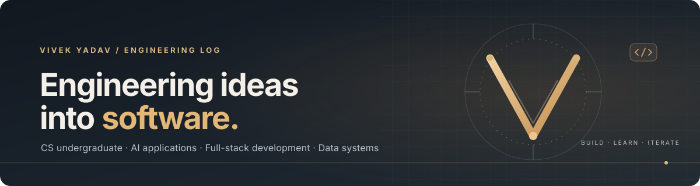

  

  <a href="https://www.linkedin.com/in/vivek-neural-vibe/">LinkedIn</a>
  &nbsp;·&nbsp;
  <a href="mailto:vivek.neuralvibe@gmail.com">Email</a>
  &nbsp;·&nbsp;
  <a href="https://www.codechef.com/users/wayne_vibes">CodeChef</a>

## About

I'm a Computer Science undergraduate interested in building practical software, AI-powered applications, and data-driven tools. I build with Python and JavaScript/TypeScript, use C++ for problem-solving, and enjoy turning real-world problems into clear, usable systems.

Currently strengthening my foundations in machine learning, data analysis, and software engineering.

Outside code, I enjoy value-investing frameworks, decision-making, and Vedantic philosophy.

## Selected work

### 01 · ExitLens — Subscription Cancellation Audit

**Team project · HackIIITD / ESYA'26**

A supervised audit tool for documenting friction in online subscription-cancellation journeys. It combines a Next.js interface, FastAPI backend, and TinyFish-powered browser runs to produce step timelines and evidence-linked friction reports, with candidate annotations against India's CCPA dark-pattern guidelines.

**Built with:** Python · FastAPI · Next.js · TypeScript · TinyFish

[Team repository ↗](https://github.com/Ritweek17/ExitLens-HACKIIITD)

### 02 · CENTURION — CAPF Welfare Triage

A privacy-first welfare early-warning prototype with separate experiences for Personnel, Welfare Officers, and Commanders. It uses synthetic personnel data, explainable alerts, audited intervention workflows, and aggregate-only commander views.

**Focus areas:** Privacy-aware system design · Role-based access · Explainable alerts · Human review

[Repository ↗](https://github.com/waynevivek/capf-welfare-triage-demo)

### 03 · ViCodathon 2026 — AI Technical Interview Agent

An adaptive AI interviewer that uses a candidate's cohort mission history to identify weaker curriculum topics, conduct multi-turn technical interviews, and generate structured feedback.

**Built with:** Python · FastAPI · Groq · HTML · CSS · JavaScript

[Repository ↗](https://github.com/waynevivek/ViCodathon-2026) &nbsp;·&nbsp; [Live demo ↗](https://vicodathon-2026.onrender.com)

## Technical toolkit

**Languages**  

**Frameworks & tools**  

## Currently exploring

- Machine learning foundations and practical AI application development
- Data analysis and visualization
- Data structures and algorithms in C++

---

  Building deliberately. Learning continuously.

